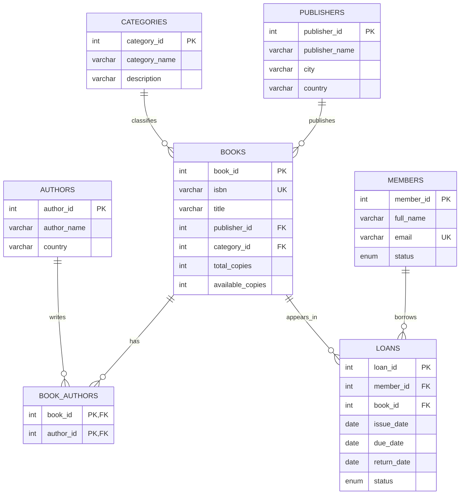

# Database Design

## Entity relationship diagram

## Design decisions

- `book_authors` implements the many-to-many relationship between books and authors.
- `loans` stores each borrowing event, preserving borrowing history.
- `books.available_copies` is maintained by triggers when a loan is issued or returned.
- Foreign keys protect relationships and prevent deleting members or books that have loan history.
- Views simplify common reporting tasks.
- Stored procedures centralize issue and return operations and validate basic business rules.

## Inventory rule

When an `ISSUED` loan is inserted, the `AFTER INSERT` trigger decreases `available_copies` by one. When an issued loan changes to `RETURNED`, the `AFTER UPDATE` trigger increases it by one.

For normal use, issue and return books through the stored procedures rather than inserting or changing loan rows manually.
